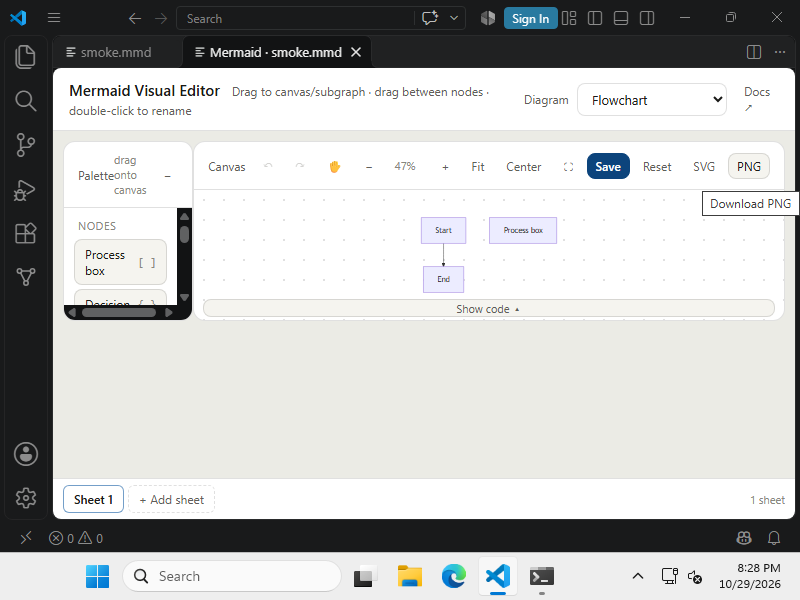

# Remote Windows UI smoke validation

Date: 2026-10-29. Scope: deploy and exercise the existing Mermaid NG VSIX on a dedicated AWS Windows test machine. The VSIX was an existing local artifact; its source revision and a fresh build were not verified in this run.

## Observed results

- AWS CLI started and stopped the instance; Systems Manager reported the Windows Server 2025 node online and executed PowerShell commands.
- VS Code 1.144.0 installed. The isolated profile listed `ngpowertoys.mermaid-visual-editor@2.5.0` after VSIX installation.
- A low-privilege account automatically entered an active console session after reboot. A scheduled task in that session captured the real VS Code desktop; Systems Manager commands alone ran in session 0.
- The Mermaid NG command appeared after the disposable VS Code profile left Restricted Mode. The webview opened `smoke.mmd` and rendered the initial two-node flowchart.
- Clicking `Process box` added a visible node. Clicking Save changed the source to include `C[Process box]`. Closing and reopening the webview showed that node in both source and canvas.
- A dedicated restricted IAM profile authenticated independently of the temporary root console login. It read the stopped instance and private test bucket. IAM simulation allowed start/stop for the test instance and denied start for another instance; a later run still needs to exercise start/stop under this profile.

## Limits and next checks

This smoke check did not exercise native swimlanes, drag and drop, comments, layout persistence, Confluence, WPF applications, or a fresh build from the extension source. The virtual desktop started at 800×600, so larger diagrams may need a higher resolution or viewport adjustment. The dedicated IAM profile uses a long-lived key protected locally; it needs periodic rotation and revocation when this test machine is retired.
